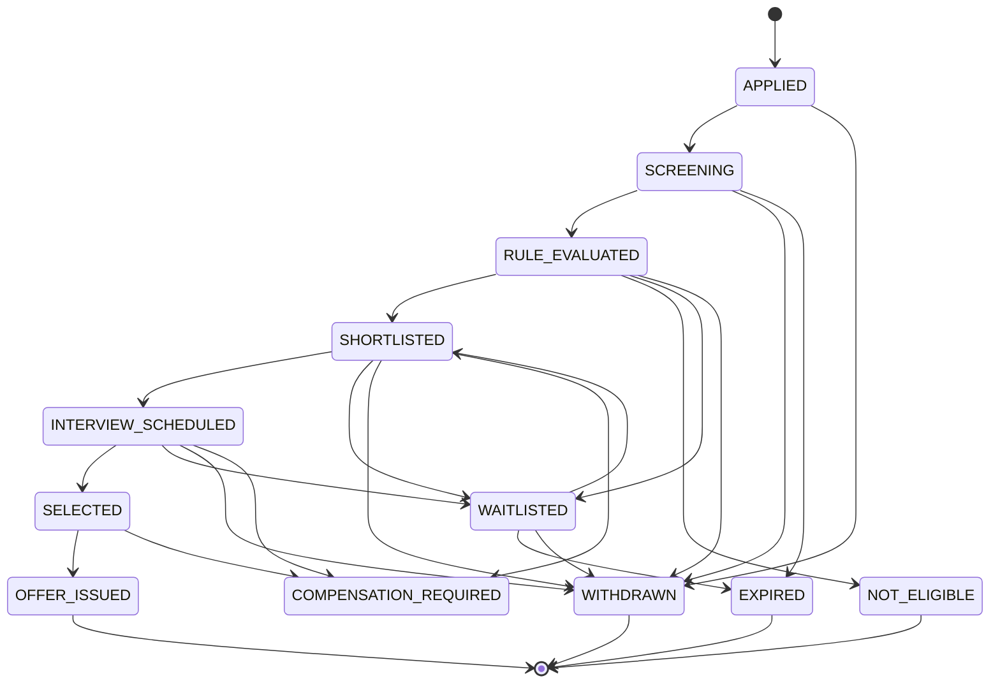

# Application State Machine Reference Specification

This document provides the authoritative state transition rules for student placement applications within the platform, as defined in `docs/01-shared-contracts-and-data-model.md` §1.4.

## Overview

- **Authoritative Owner:** Team C is the sole writer of application `state`. No other team or UI layer may mutate `state` directly.
- **Enforcement:** Every state transition must be validated against this table before committing to Team C's database engine.
- **Error Behavior:** Any attempt to perform an unlisted transition MUST be rejected with error code `STATE_CONFLICT` (HTTP 409).

---

## State Transition Table

| Current State (`From`) | Allowed Next States (`To`) | Description / Notes |
| :--- | :--- | :--- |
| *(new)* | `APPLIED` | Initial application creation by student. |
| `APPLIED` | `SCREENING`, `WITHDRAWN` | Intake validated; moves to rule screening or student withdraws. |
| `SCREENING` | `RULE_EVALUATED`, `WITHDRAWN`, `EXPIRED` | Enqueued/evaluated by Team A rule engine; or expired/withdrawn. |
| `RULE_EVALUATED` | `SHORTLISTED`, `NOT_ELIGIBLE`, `WAITLISTED`, `WITHDRAWN` | Rule chain result applied. |
| `SHORTLISTED` | `INTERVIEW_SCHEDULED`, `WAITLISTED`, `WITHDRAWN`, `COMPENSATION_REQUIRED` | Interview slot reserved or queued for interview. |
| `INTERVIEW_SCHEDULED` | `SELECTED`, `WAITLISTED`, `WITHDRAWN`, `COMPENSATION_REQUIRED` | Interview conducted and candidate selected/waitlisted. |
| `SELECTED` | `OFFER_ISSUED`, `COMPENSATION_REQUIRED` | Offer commit sequence initiated by Team C (C3). |
| `OFFER_ISSUED` | *(terminal)* | Final success state. Application complete. |
| `NOT_ELIGIBLE` | *(terminal)* | Final failure state. Failed eligibility rules. |
| `WAITLISTED` | `SHORTLISTED`, `EXPIRED`, `WITHDRAWN` | Waiting for slot opening; can be promoted to `SHORTLISTED`. |
| `WITHDRAWN` | *(terminal)* | Final state. Student voluntarily withdrew. |
| `EXPIRED` | *(terminal)* | Final state. Drive or queue deadline expired. |
| `COMPENSATION_REQUIRED` | *(re-enters state)* | **Transient state:** Re-enters the state it failed from after compensation completes; never exposed as a resting state beyond that transaction. |

---

## Terminal States

The following states are **terminal**. Once an application enters a terminal state, no further transitions are permitted:
1. `OFFER_ISSUED`
2. `NOT_ELIGIBLE`
3. `WITHDRAWN`
4. `EXPIRED`

---

## Visual State Flow Diagram

